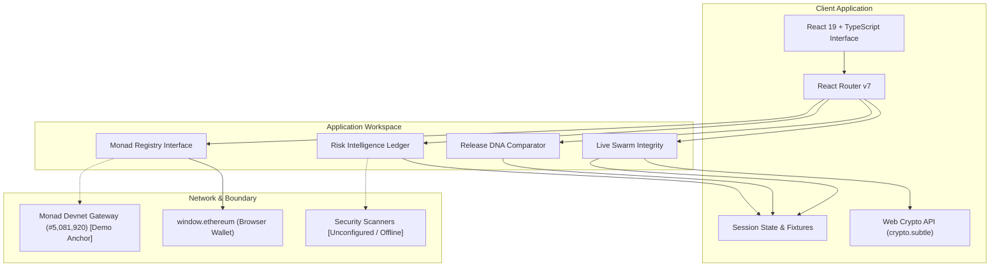
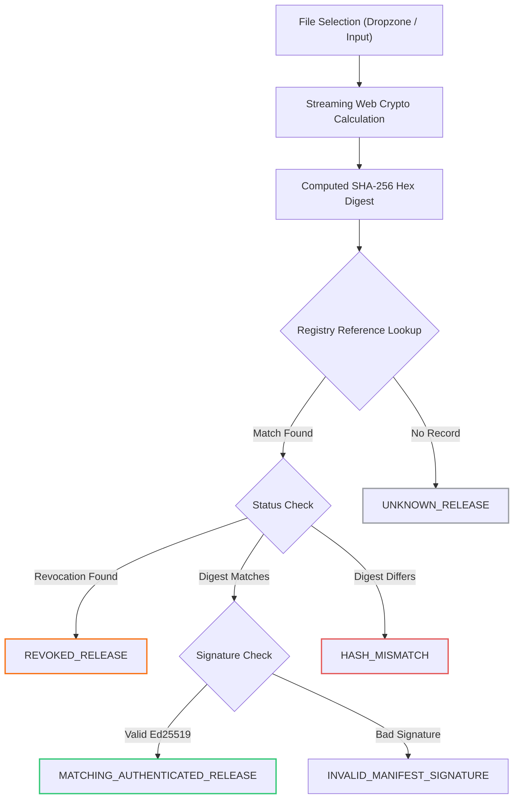
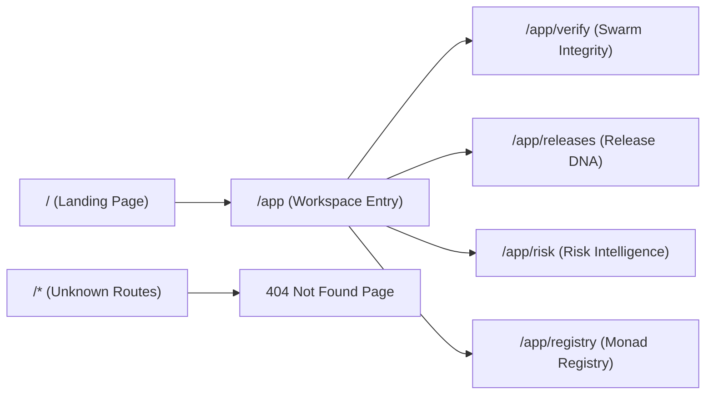

# PENGUIN TRACE

Deterministic Web3 file provenance and cryptographic integrity verification platform built on Monad.

---

## Overview

Penguin Trace enables developers, node operators, and security auditors to verify binary authenticity and file integrity before running untrusted software. The platform performs zero-trust, browser-side SHA-256 digest calculations and compares artifacts against on-chain release commitments and cryptographic manifests.

The system uses the classic Linux Tux mascot as its visual brand mark, reinforcing open-source software security and verifiable distribution.

---

## Architecture

The application runs entirely client-side using Vite, React 19, TypeScript, and the browser Web Crypto API. File payloads never leave the user machine during hashing.



---

## Verification Pipeline



---

## Route Structure



| Path | Name | Description |
|---|---|---|
| `/` | Landing Page | Cinematic overview, hero section, platform preview, and documentation modal access. |
| `/app` | Workspace Root | Automatically resolves to the primary verification workflow. |
| `/app/verify` | Live Swarm Integrity | Browser-side SHA-256 calculation, drag-and-drop, and status validation. |
| `/app/releases` | Release DNA | Side-by-side artifact comparison, version lineage timeline, and byte variance. |
| `/app/risk` | Risk Intelligence | Multi-vector evidence ledger, vector filtering, and scanner audit states. |
| `/app/registry` | Monad Registry | On-chain contract commitments, RPC network info, and Web3 wallet status. |
| `*` | 404 Recovery | Fallback route with Tux mascot and return navigation. |

---

## Cryptographic Security Principles

Penguin Trace strictly differentiates between three distinct security concepts:

### 1. File Integrity
Guarantees that a downloaded file matches an expected byte sequence without corruption or transit alteration. This is validated by calculating the local SHA-256 digest using `crypto.subtle.digest` and comparing it to the registered digest.

### 2. Publisher Authenticity
Guarantees that the expected digest was attested by an authorized publisher key. This is validated via Ed25519 signature checks against the publisher's public key registered in the on-chain registry.

### 3. Malware and Vulnerability Status
Binary scanning inspects the payload for known malware signatures or behavioral anomalies. 

Crucial operational guarantees:
- A hash match confirms authenticity and integrity, but does not guarantee the absence of zero-day vulnerabilities.
- A hash mismatch indicates data divergence, but does not identify malicious intent.
- Unregistered hashes are labeled `UNKNOWN_RELEASE` (unknown provenance), not malicious.
- Unavailable or offline scanners are labeled `SCANNER_UNAVAILABLE` or `NOT_SCANNED`, never reported as clean.

---

## Implementation Status & Boundary Matrix

| Capability | Status | Notes |
|---|---|---|
| Web Crypto SHA-256 | Implemented | Local in-browser execution with real byte hashing and copy feedback. |
| Top Bar Navigation | Implemented | Sidebar removed; full-width workspace with responsive mobile menu. |
| Return Home Navigation | Implemented | Tux mascot and wordmark navigate to `/` with accessibility focus rings. |
| Typography System | Implemented | Google Sans / Open Sans heading and interface typography stack. |
| Release DNA Comparator | Implemented | Interactive side-by-side binary comparison with delta metrics. |
| Risk Intelligence Ledger | Implemented | Vector filtering by category and status with audit panel. |
| Seed Registry Data | Demo Fixture | Built-in release fixtures for Monad nodes v0.8.0 through v0.8.2. |
| Web3 Wallet Connection | Client Ready | Interacts with `window.ethereum`; prompts user on supported providers. |
| Monad Contract Writes | Unconfigured | Real on-chain release registration requires deployed contract ABI and gas. |
| Third-Party AV Scanners | Unconfigured | Offline by policy; displays honest `NOT_SCANNED` states. |

---

## Technology Stack

- **Framework**: React 19 (`react`, `react-dom`)
- **Build Tool**: Vite 8 with HMR
- **Language**: TypeScript 5
- **Routing**: React Router v7 (`react-router-dom`)
- **Styling**: Tailwind CSS v4 (`tailwindcss`, `@tailwindcss/vite`)
- **Icons**: Lucide React (`lucide-react`)
- **Cryptography**: W3C Web Cryptography API (`window.crypto.subtle`)
- **Design Tokens**: Cinematic Dark Theme (`#070708`, `#101112`, `#1B1C1E`, `#5E6BFF`)

---

## Getting Started

### Prerequisites

- Node.js 18.0.0 or higher
- npm 9.0.0 or higher

### Installation

```bash
# Clone the repository
git clone https://github.com/Shrysxs/monad-v3.git
cd monad-v3

# Switch to the frontend branch
git checkout frontend

# Install dependencies
npm install
```

### Development Server

```bash
npm run dev
```

The development server will start locally at `http://localhost:5173/` (or the next available port).

### Production Build

```bash
npm run build
```

The production output will be generated in the `dist/` directory.

### Code Quality & Type Checks

```bash
# Run ESLint checks
npm run lint

# Run TypeScript compilation checks
npx tsc --noEmit
```

---

## Keyboard Shortcuts

| Shortcut | Action | Scope |
|---|---|---|
| <kbd>Cmd</kbd> + <kbd>K</kbd> / <kbd>Ctrl</kbd> + <kbd>K</kbd> | Open Quick Hash Inspector | Global Workspace |
| <kbd>Escape</kbd> | Close active modal | Global |
