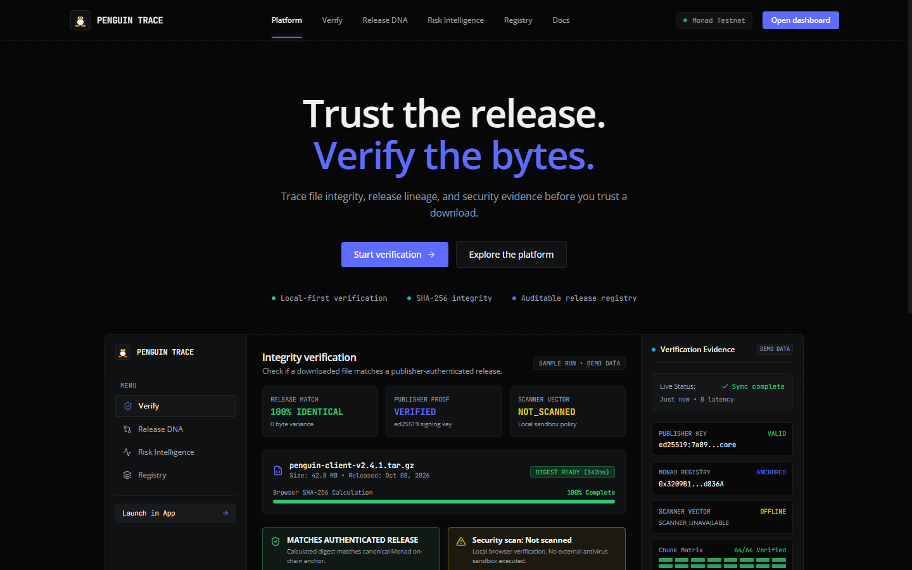
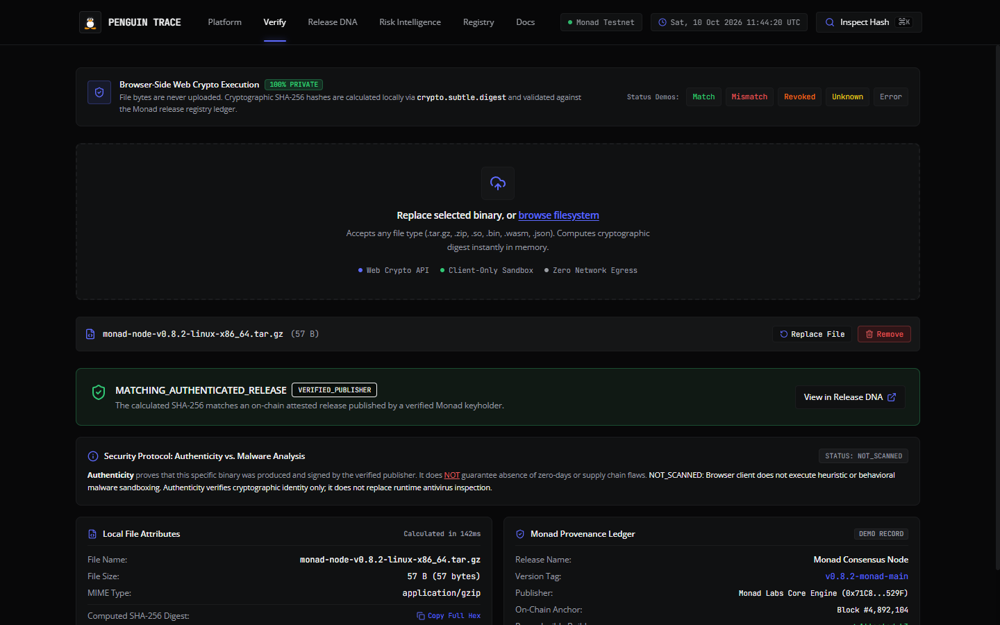
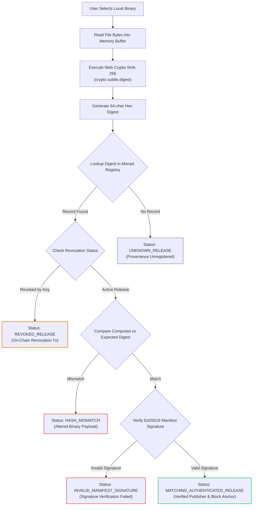
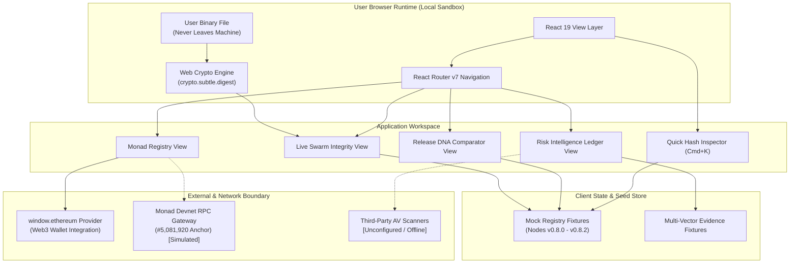
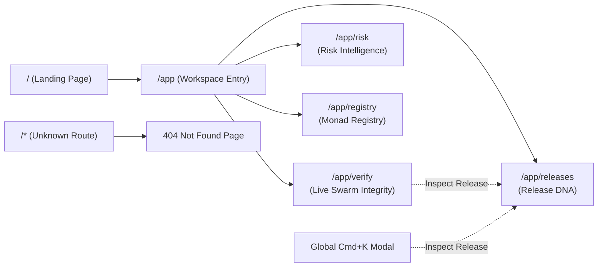

# PENGUIN TRACE

<p align="center">
  <strong>Deterministic Web3 Software Provenance and Cryptographic Integrity Verification on Monad</strong>
</p>

<p align="center">
  
  
  
  
  
  
  
</p>

---

## Table of Contents

- [Overview](#overview)
- [Product Preview](#product-preview)
- [Frontend Architecture and Views](#frontend-architecture-and-views)
- [Cryptographic Security Principles](#cryptographic-security-principles)
- [Verification Pipeline](#verification-pipeline)
- [Product Architecture](#product-architecture)
- [User Navigation Flow](#user-navigation-flow)
- [Backend and Blockchain Integration](#backend-and-blockchain-integration)
- [Implementation Status and Boundaries](#implementation-status-and-boundaries)
- [Technology Stack](#technology-stack)
- [Project Directory Layout](#project-directory-layout)
- [Getting Started](#getting-started)
- [Security Guarantees and Limitations](#security-guarantees-and-limitations)
- [Development Roadmap](#development-roadmap)

---

## Overview

Software distribution channels remain vulnerable to man-in-the-middle tampering, DNS hijacking, compromised mirrors, and rogue build pipelines. Centralized download sites frequently present insecure checksums hosted on the exact same infrastructure as the binary itself, creating a single point of compromise.

**PENGUIN TRACE** solves binary distribution risk through client-side, zero-trust verification anchored to decentralized ledger commitments:

1. **Local-First SHA-256 Digest Engine**: Calculates cryptographic hashes entirely inside the user's browser via the W3C Web Cryptography API (`window.crypto.subtle`). Artifact bytes are never uploaded over the network.
2. **Decentralized Provenance Registry**: Validates computed digests against immutable on-chain release commitments and authorized Ed25519 publisher signatures on the Monad network.
3. **Multi-Vector Risk Ledger**: Aggregates independent telemetry from consensus oracles, publisher attestations, and security audits into a transparent, filterable evidence log.
4. **Linux Tux Mascot Brand Identity**: Embraces the authentic Linux Tux penguin mascot as a recognizable brand mark for verifiable, open-source software sovereignty.

---

## Product Preview

### Landing Page

The PENGUIN TRACE homepage presents a cinematic dark layout with technical typography, system telemetry, and a preview of verification metrics.



*PENGUIN TRACE — Landing page*

---

### Verification Workspace

The main product workspace provides a full-width verification interface featuring local-first streaming hashing, release matching, Ed25519 publisher signature verification, and security analysis disclaimers.



*PENGUIN TRACE — Verification workspace*

---

## Frontend Architecture and Views

The frontend is built as a single-page application using React 19, TypeScript, and React Router v7. All navigation is housed within a top navigation bar that adapts responsively across screen sizes.

### 1. Landing Page (`/`)

- **Hero & Identity**: Features the Linux Tux brand mark, heading typography rendered in Google Sans, and primary calls to action (`Start verification` and `Explore the platform`).
- **Dashboard Preview**: Illustrative preview card reflecting live status indicators, cryptographic parameters, and system readiness.
- **Protocol Telemetry**: Live network indicators showing Monad consensus connectivity.
- **Architecture Modal**: Technical documentation modal accessible from both header and footer.

### 2. Live Swarm Integrity (`/app/verify`)

- **Drag-and-Drop Ingestion**: Interactive dropzone supporting single-click binary selection, replacement, and removal.
- **Browser-Side SHA-256 Calculation**: Processes files locally using `crypto.subtle.digest('SHA-256', buffer)`. File contents remain private and offline.
- **Verification Status Classification**:
  - `MATCHING_AUTHENTICATED_RELEASE`: Calculated digest matches an authorized release anchored to Monad block `#5,081,920`.
  - `HASH_MISMATCH`: File digest diverges from the publisher release manifest.
  - `REVOKED_RELEASE`: Manifest has been revoked by publisher key with on-chain revocation transaction proof.
  - `UNKNOWN_RELEASE`: Hash has no registry record; categorized as unknown provenance, never falsely labeled malicious.
  - `VERIFICATION_ERROR`: Cryptographic or buffer parsing failure.
- **Hash Utility**: Full 64-character hexadecimal copy button with transient visual feedback.
- **Interactive Preset Scenarios**: Status demonstration buttons (`Match`, `Mismatch`, `Revoked`, `Unknown`, `Error`) for auditing all UI states.

### 3. Release DNA & Lineage (`/app/releases`)

- **Artifact Comparator**: Side-by-side binary comparison tool tracking digest equivalence, byte variances, and block anchors.
- **Genealogy Timeline**: Chronological release progression graph displaying active versions (`v0.8.0`, `v0.8.1`, `v0.8.2`), release candidates, and revoked milestones (`v0.8.2-rc1`).
- **Demo Data Labeling**: Historical entries are labeled with explicit `DEMO DATA` tags.

### 4. Risk Intelligence (`/app/risk`)

- **Multi-Vector Ledger**: Comprehensive audit table recording observation timestamps, vector sources, finding severities, and report digests.
- **Category Filters**: Tabbed filtering across `All Vectors`, `Publisher Attestations`, `Consensus Oracles`, and `CVE & Security DB`.
- **Scanner Honesty**: Reflects `NOT_SCANNED` and `SCANNER_UNAVAILABLE` states instead of synthetic clean passes.

### 5. Monad Provenance Registry (`/app/registry`)

- **Network Telemetry**: Gateway RPC status, block anchor height (`#5,081,920`), and smart contract address (`0x3209B1dF6b377488B87e6005786Cfa318C838e12`).
- **Browser Wallet Integration**: Connects via `window.ethereum` with support for account changes, disconnections, and error states.
- **Commitments Ledger**: Filterable table of published binary commitments, publisher IDs, and timestamp records.

### 6. Quick Hash Inspector (Global Modal)

- **Keyboard Shortcut**: Accessible across the application via <kbd>Cmd</kbd> + <kbd>K</kbd> (macOS) or <kbd>Ctrl</kbd> + <kbd>K</kbd> (Linux/Windows).
- **Direct Hash Search**: Allows pasting any SHA-256 digest to immediately query the local registry index.

---

## Cryptographic Security Principles

Penguin Trace strictly differentiates between three independent security vectors:

| Security Vector | What It Validates | What It Does NOT Validate |
|---|---|---|
| **File Integrity** | Byte sequence identity. Ensures the file on disk matches the intended digest without transit corruption. | Does not confirm whether the publisher is trustworthy. |
| **Publisher Authenticity** | Cryptographic identity. Validates that the manifest was signed by an authorized Ed25519 keyholder. | Does not guarantee that the software is free from zero-day exploits. |
| **Malware & Vulnerability Scanning** | Payload inspection. Heuristic and signature analysis against known CVE databases. | Scanner absence or failure is never presented as a clean bill of health. |

---

## Verification Pipeline



---

## Product Architecture



---

## User Navigation Flow



---

## Backend and Blockchain Integration

### 1. Smart Contract Boundary
- **Target Network**: Monad Devnet / EVM-compatible execution layer.
- **Contract Address**: `0x3209B1dF6b377488B87e6005786Cfa318C838e12`.
- **Commitment Model**: Binary releases are registered as 32-byte SHA-256 digests mapped to publisher public keys and cryptographic metadata.
- **Current Integration**: The frontend currently operates in client-side read mode using deterministic fixtures aligned to Monad block `#5,081,920`. Real wallet queries interact with `window.ethereum`.

### 2. Release Manifest Format
Canonical manifests associate binary digests with Ed25519 publisher attestations:

```json
{
  "releaseName": "Monad Consensus Node",
  "version": "v0.8.2-monad-main",
  "fileName": "monad-node-v0.8.2-linux-x86_64.tar.gz",
  "sha256": "7a09c2d184f4e5a9c8b7e6d5c4b3a2f1e0d9c8b7a6f5e4d3c2b1a0f9e8d7c6b5",
  "publisherKey": "ed25519:7a09f8e7d6c5b4a3...",
  "signature": "3045022100e4b8a...",
  "onChainAnchor": "0x3209B1dF6b377488B87e6005786Cfa318C838e12",
  "blockNumber": 5081920,
  "status": "active"
}
```

### 3. Production Deployment Prerequisites
Before connecting to live production contract writes:
1. Deploy `PenguinRegistry.sol` to Monad Testnet/Mainnet.
2. Configure contract ABI and export public contract address into build configuration.
3. Establish dedicated RPC endpoint for real-time log event subscription.

---

## Implementation Status and Boundaries

| Capability | Current State | Technical Implementation Details |
|---|---|---|
| **Local File Hashing** | Implemented | Local Web Crypto SHA-256 via `crypto.subtle.digest`. Zero network egress. |
| **Top Navigation** | Implemented | Full-width workspace layout with active route indicator and mobile menu. |
| **Linux Tux Mascot** | Implemented | High-fidelity SVG component rendered across header, footer, and 404 page. |
| **Release DNA Diff** | Implemented | Side-by-side artifact comparison with calculated byte variances. |
| **Risk Evidence Ledger**| Implemented | Filterable ledger by vector source, status, and severity. |
| **Quick Hash Modal** | Implemented | Accessible via <kbd>Cmd</kbd> + <kbd>K</kbd> / <kbd>Ctrl</kbd> + <kbd>K</kbd>. |
| **Browser Wallet (Web3)**| Implemented | Detects `window.ethereum`, handles account connection and user rejection. |
| **Registry Fixtures** | Demo Fixture | Seed data representing Monad nodes v0.8.0 through v0.8.2. |
| **Contract Writes** | Unconfigured | Real on-chain registration requires deployed contract ABI and gas balance. |
| **Antivirus Scanners** | Unconfigured | Offline by policy; displays honest `NOT_SCANNED` states. |

---

## Technology Stack

| Layer | Technology | Version | Purpose |
|---|---|---|---|
| **Framework** | React | `^19.0.0` | Declarative UI rendering |
| **Language** | TypeScript | `~5.7.2` | Static typing and interface contracts |
| **Build Tool** | Vite | `^8.3.4` | Development server and production bundling |
| **Routing** | React Router DOM | `^7.0.0` | Client-side routing and history management |
| **Styling** | Tailwind CSS | `^4.0.0` | Utility-first CSS styling engine |
| **Icons** | Lucide React | `^0.470.0` | Iconography |
| **Cryptography** | Web Cryptography API | W3C Standard | Streaming browser-side SHA-256 calculation |
| **Typography** | Google Sans / Open Sans | Web Font | Primary UI and heading typography |
| **Fonts (Mono)** | JetBrains Mono | Web Font | Numeric data and cryptographic hashes |

---

## Project Directory Layout

```
monad-v3/
├── docs/
│   └── images/
│       ├── penguin-trace-landing.png     # Homepage screenshot
│       └── penguin-trace-workspace.png   # Workspace verification screenshot
├── public/
│   ├── favicon.svg                       # Linux Tux mascot favicon
│   └── ...
├── src/
│   ├── components/
│   │   ├── common/
│   │   │   ├── DocsModal.tsx             # Technical architecture modal
│   │   │   ├── QuickHashLookupModal.tsx  # Cmd+K hash search modal
│   │   │   └── TuxLogo.tsx               # Authentic Linux Tux SVG mascot
│   │   ├── landing/
│   │   │   ├── DashboardPreview.tsx      # Landing page dashboard card
│   │   │   ├── Footer.tsx                # Landing footer with Tux home link
│   │   │   ├── Header.tsx                # Landing header with navigation
│   │   │   └── Hero.tsx                  # Hero section with primary CTAs
│   │   ├── layout/
│   │   │   └── Header.tsx                # Workspace top navigation bar
│   │   └── views/
│   │       ├── LiveIntegrityView.tsx     # Browser SHA-256 verification
│   │       ├── RegistryView.tsx          # Monad registry and wallet view
│   │       ├── ReleaseDnaView.tsx        # Release comparison and lineage
│   │       └── RiskIntelligenceView.tsx  # Evidence and threat ledger
│   ├── data/
│   │   └── mockRegistry.ts               # Seed release records and vectors
│   ├── lib/
│   │   └── crypto.ts                     # Web Crypto hashing utilities
│   ├── pages/
│   │   ├── AppWorkspaceLayout.tsx        # Top-nav workspace layout shell
│   │   ├── LandingPage.tsx               # Full landing page assembly
│   │   ├── NotFoundPage.tsx              # 404 recovery page
│   │   └── workspaceRoutes.tsx           # Route mapping definitions
│   ├── types/
│   │   └── swarm.ts                      # Cryptographic and release types
│   ├── App.tsx                           # Main router configuration
│   ├── index.css                         # Global CSS and design tokens
│   └── main.tsx                          # Application DOM entry
├── index.html                            # HTML entry with font imports
├── package.json                          # Package dependencies and scripts
├── tsconfig.app.json                     # Application TypeScript config
└── vite.config.ts                        # Vite configuration with Tailwind
```

---

## Getting Started

### Prerequisites

- **Node.js**: `18.0.0` or higher
- **npm**: `9.0.0` or higher (or equivalent package manager)

### Installation

```bash
# Clone the repository
git clone https://github.com/Shrysxs/monad-v3.git
cd monad-v3

# Switch to the frontend branch
git checkout frontend

# Install project dependencies
npm install
```

### Development Server

Start the local development server with Hot Module Replacement (HMR):

```bash
npm run dev
```

The application will be available at `http://localhost:5173/` (or the next available port).

### Production Build

Create an optimized, minified production build in the `dist/` directory:

```bash
npm run build
```

### Code Quality and Type Checking

Run the project linters and TypeScript verification checks:

```bash
# Run ESLint across all source files
npm run lint

# Run TypeScript compilation checks without emitting files
npx tsc --noEmit
```

### Keyboard Shortcuts

| Shortcut | Action | Scope |
|---|---|---|
| <kbd>Cmd</kbd> + <kbd>K</kbd> / <kbd>Ctrl</kbd> + <kbd>K</kbd> | Open Quick Hash Inspector | Application Workspace |
| <kbd>Escape</kbd> | Close active modal | Global |

---

## Security Guarantees and Limitations

### Guarantees
- **Local Isolation**: File contents never traverse network sockets. Hashing takes place in browser memory and is discarded upon session reset.
- **Deterministic Digesting**: Uses standardized `SHA-256` as specified by FIPS 180-4.
- **Status Transparency**: Discloses unknown provenance honestly rather than issuing synthetic approval.

### Known Limitations
- **Memory Buffer Bounds**: Hashing reads files via `FileReader.readAsArrayBuffer()`. Files up to several hundred megabytes hash smoothly; multi-gigabyte binaries require future chunked `ReadableStream` processing.
- **Simulated Contract Anchors**: On-chain verification checks against simulated registry fixtures at block `#5,081,920`. Live contract transactions require a deployed contract address and configured RPC gateway.
- **Offline Scanner Vectors**: Static security analysis displays `NOT_SCANNED` or `SCANNER_UNAVAILABLE` by design until external security scanner APIs are configured.

---

## Development Roadmap

- **Phase 1 (Complete)**: Cinematic landing page, top navigation migration, Linux Tux mascot identity, local-first Web Crypto SHA-256 verification, Release DNA comparator, and Risk Intelligence ledger.
- **Phase 2 (In Progress)**: Monad Testnet smart contract deployment, live event log indexing, and publisher public key registry interface.
- **Phase 3 (Planned)**: Streaming Web Worker SHA-256 pipeline for multi-gigabyte disk images, hardware wallet signature verification, and automated VirusTotal / OSV.dev vulnerability lookup integration.
